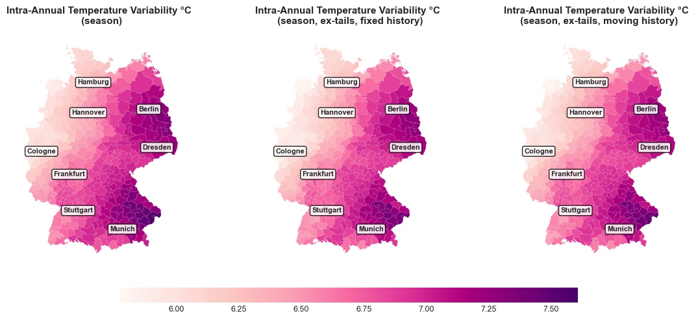
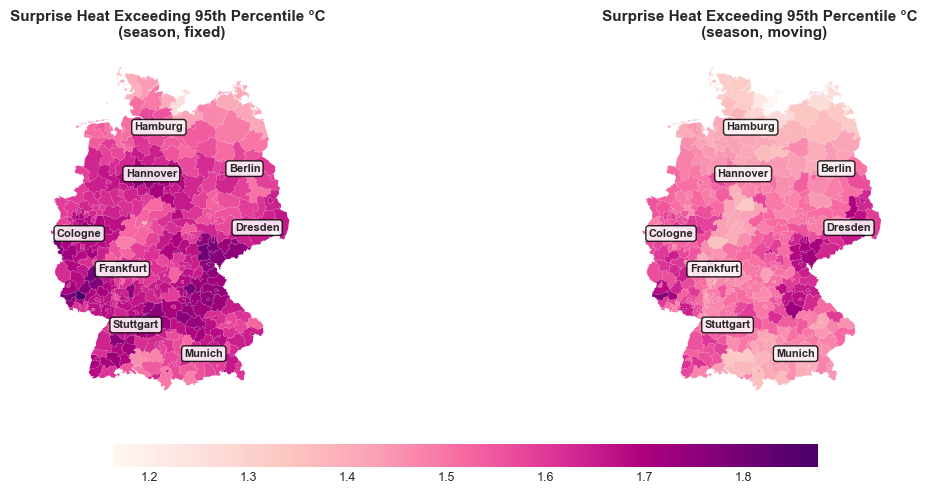
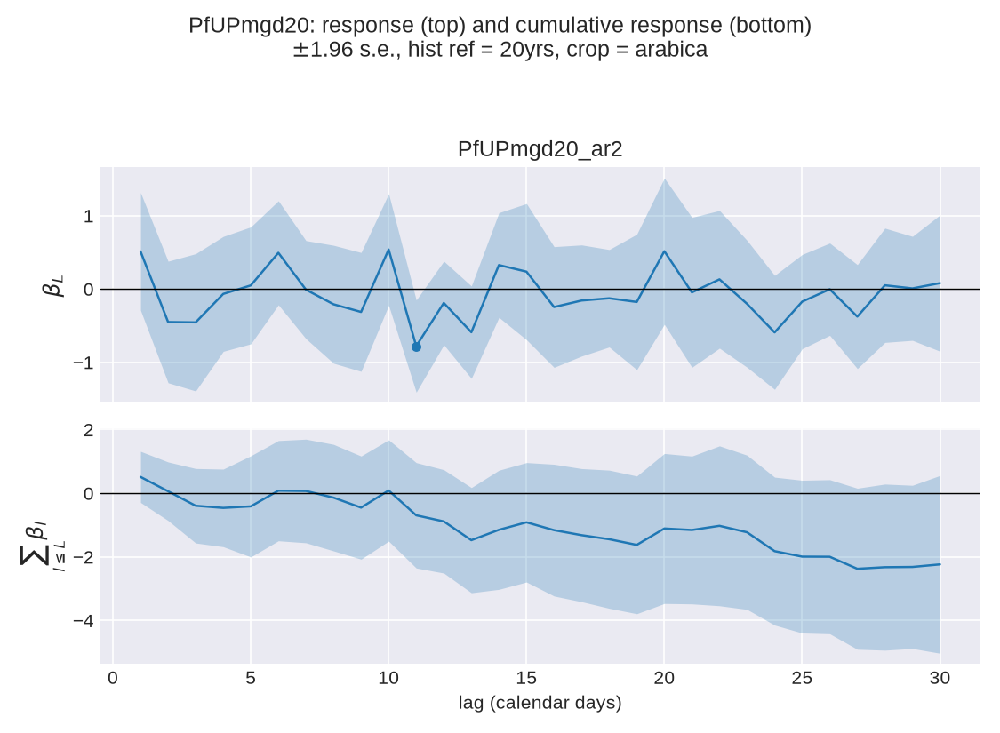
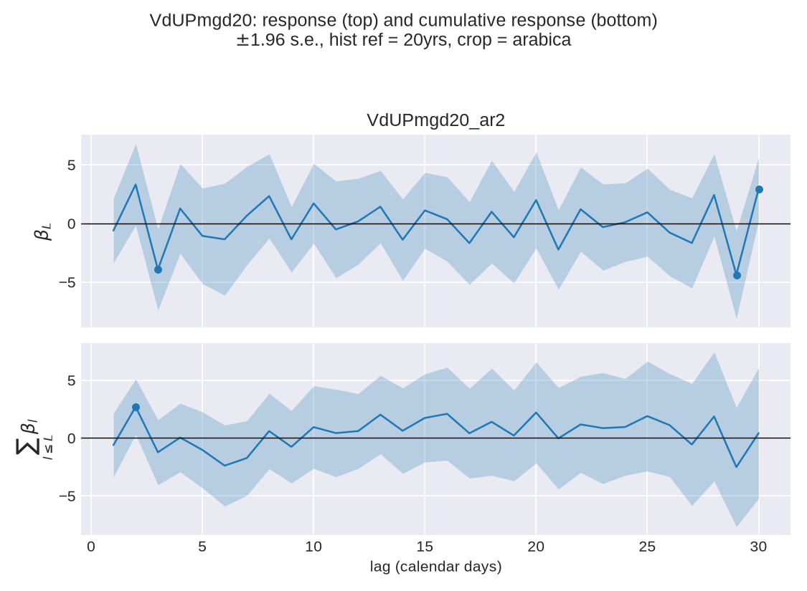
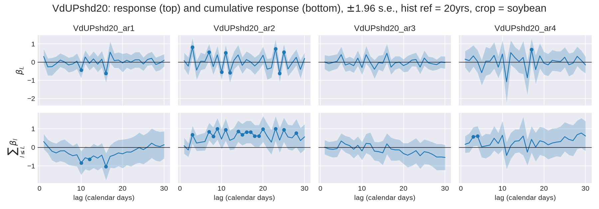

# Physical Climate Risk | Spatial Econometrics | Causal Inference

### Phd Thesis: Essays on Climate Econometrics, the Measurement of Local Evolving Weather Shocks, and Estimating the Marco- and Financial-Fallout of Anomalous Weather
*[Link to Chapter Abstracts](major_contributions/readme.md)*

I connect localized meteorological anomalies from gridded climate reanalysis data into macro-economic growth, agricultural farm yields and agricultural futures returns

`Empirical Pipelines` | `Custom Econometric Estimators` | `Geospatial Workflows` | `Robust Machine Learning`

---

## Core Methodological Contributions

1. **[Dynamic Rolling Baselines & Accelerated Warming](major_contributions/01_rolling_baselines.md)** — Isolating unanticipated weather shocks from secular warming using lagged 20- and 30-year rolling reference windows ($\pm 5\text{-day}$ calendar pooling on `Zarr` + `CuPy`).
2. **[Panel Econometrics for Macro-Climate Shocks](major_contributions/02_panel_econometrics.md)** — Multi-dimensional fixed-effects identification across 400 German counties (`HYRAS-DE`, 1995–2019). Custom Frisch–Waugh–Lovell (FWL) matrix projection, Conley spatial HAC standard errors
3. **[Spatial Data Leakage in ML Yield Models](major_contributions/03_spatial_data_leakage.md)** — Reviewing classical XGBoost application in agro-economics, and finding that random train-test splits inflate XGBoost out-of-sample $R^2$ gains by ~75% via spatial signature memorization.
4. **[Grids to Sub-regions with Empirical Backtesting](major_contributions/04_spatial_engineering.md)** — Taking the product of cropland area weights and grid-level climate anomalies yields daily sub-regional shock series, validated against headline historical droughts and floods across Central South America.
5. **[Two-Stage Orthogonalized ARX Futures Pricing](major_contributions/05_arx_timeseries.md)** — Partialing out financial/calendar controls before estimating 30-lag multi-quadrant ARX impulse responses for Arabica coffee and soybeans.

---

## Major Empirical Findings

### 1. Stranger Weather: Regional Growth Losses Across 400 German Counties
* **Threshold Sensitivity:** Estimated annual GDP per capita growth loss from local heat shocks is **$0.11\text{pp}$** under seasonal thresholds and **$0.12\text{pp}\text{--}0.24\text{pp}$** under monthly thresholds.
* **Intra-Annual Volatility:** A $1\text{ SD}$ increase in within-year temperature variability reduces annual regional growth by **$0.50\text{pp}$** (seasonal) and **$0.33\text{pp}$** (monthly).
* **Econometric Robustness:** FWL orthogonalization against county and year fixed effects, county-specific quadratic time trends, Conley spatial HAC standard errors, and county-clustered standard errors.

| Intra-Annual Temperature Volatility Vulnerability | Cumulative Heat Shock Exposure (2005–2019) |
| :---: | :---: |
|  |  |
| *East and south-eastern counties exhibit the highest vulnerability to intra-annual temperature fluctuations.* | *South-west and south-eastern counties experienced heightened heat shock frequency, while the central corridor remained moderate.* |

---

### 2. Hide and (can't) Seek: Spatial Data Leakage in XGBoost Yield Predictions
> *Pipeline and diagnostic plots currently syncing from workstation — full spatial cross-validation benchmarks and SHAP attribution charts incoming.*

* **Core Finding:** Across 22,331 Indian rice-growing households (551 districts), random household train-test splits inflate climate-driven out-of-sample $R^2$ gains by **~75%** ($+17.8\text{pp}$ vs. $+4.4\text{pp}$ under district-blind validation) due to spatial signature memorization.

| Split | Climate | Test $R^2$ | Test RMSE | Test MAE | Train $R^2$ |
| :--- | :--- | :---: | :---: | :---: | :---: |
| **Household** | No | $0.397$ $(0.392\text{--}0.405)$ | $0.140$ $(0.138\text{--}0.141)$ | $0.103$ $(0.102\text{--}0.103)$ | $0.760$ |
| **District** | No | $0.331$ $(0.309\text{--}0.370)$ | $0.143$ $(0.141\text{--}0.145)$ | $0.107$ $(0.104\text{--}0.108)$ | $0.485$ |
| **Household** | Yes | $0.576$ $(0.563\text{--}0.595)$ | $0.117$ $(0.113\text{--}0.120)$ | $0.082$ $(0.081\text{--}0.084)$ | $0.858$ |
| **District** | Yes | $0.371$ $(0.344\text{--}0.427)$ | $0.139$ $(0.135\text{--}0.143)$ | $0.103$ $(0.100\text{--}0.106)$ | $0.660$ |
| **Household** | Shuffled | $0.562$ $(0.545\text{--}0.577)$ | $0.119$ $(0.115\text{--}0.123)$ | $0.084$ $(0.083\text{--}0.086)$ | $0.856$ |
| **District** | Shuffled | $0.266$ $(0.234\text{--}0.313)$ | $0.150$ $(0.147\text{--}0.154)$ | $0.113$ $(0.111\text{--}0.117)$ | $0.486$ |

*Out-of-sample performance by split design and feature set (XGBoost). Test metrics are means across seeds, with the minimum and maximum in parentheses.*

---

### 3. Area of Effects: Asymmetric Price Adjustments in Agricultural Futures
Financial markets price localized weather shocks in core Brazilian producing states (**São Paulo, Paraná, Rio Grande do Sul, and Minas Gerais**) differently depending on crop physiology and spatial footprint:

* **Arabica Coffee Futures (`KC=F`) — Intensive Margin Sensitivity:**  
  Concentrated growing footprint ($\sim 20{,}000\text{ km}^2$; high moisture requirement of $\sim 2{,}200\text{ mm}$). Intense localized **Precipitation Flux** triggers bearish return adjustments of **$-0.09\text{pp}$ to $-0.16\text{pp}$** within $2\text{--}3$ trading days. **High and Intense VPD** triggers immediately spikes in arabica returns **$+0.08\text{pp}$ to $+0.14\text{pp}$**, spikes persist for $1\text{--}2$ trading days.

  
   
  <em>30-day impulse responses of Arabica coffee futures returns in core Brazilian growing regions: bearish adjustment following intense precipitation flux (left) alongside an immediate, transient bullish spike driven by intense atmospheric dryness (right).</em>

* **Soybean Futures (`ZS=F`) — Extensive Margin Sensitivity:**  
  Expansive growing footprint ($\sim 150{,}000\text{ km}^2$; lower water threshold of $\sim 750\text{ mm}$). Spatially dispersed **Dryness Shocks (VPD)** drive bullish cumulative return gains of **$+0.06\text{pp}$ to $+0.11\text{pp}$** accumulating persistently over a 30-day horizon.

  

     
    <em>Cumulative 30-day response of soybean futures returns to spatially dispersed dry shocks. Sub-regions <code>ar2</code> and <code>ar4</code> correspond to core Brazilian producing states; estimates remain robust to leave-one-sub-region-out exclusion.</em>
  

* **Econometric & Geospatial Robustness:** FWL orthogonalization against month and year fixed effects, `MAPSPAM` production-area-weighted grid aggregation (`AgERA5` $0.1^\circ$), KPSS & ADF stationarity diagnostics on all regressors, and Newey–West / Bartlett kernel HAC covariance estimation.
