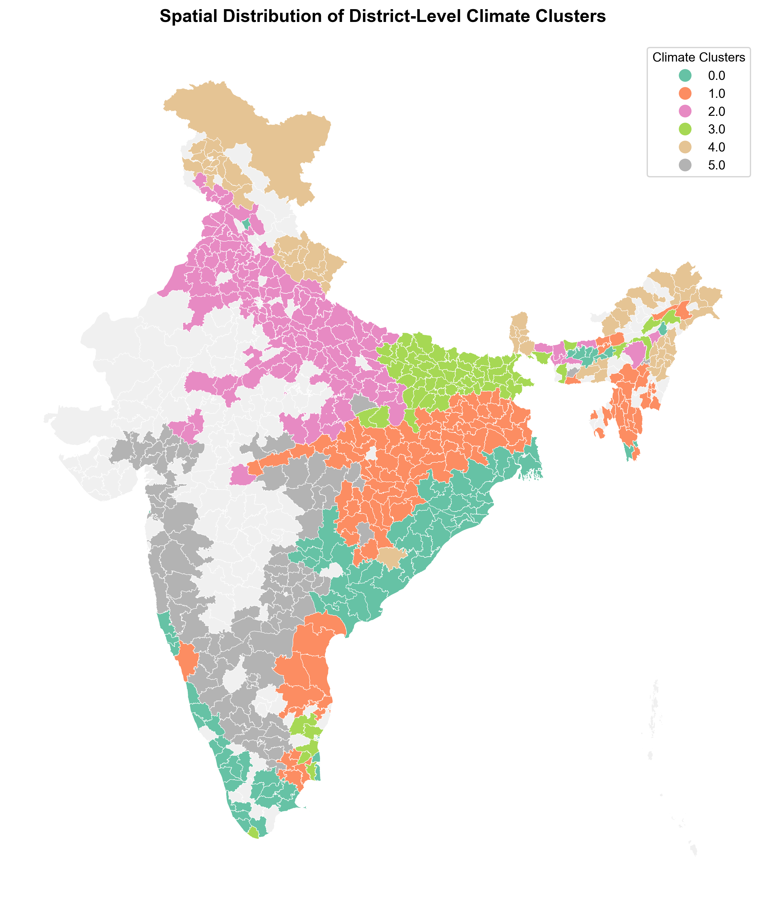

# Spatial Data Leakage in ML Crop Yield Predictions

Gradient-boosted decision trees (`XGBoost`) cannot extrapolate beyond the support of their training feature space—yet naive spatial holdouts force trees to predict into unseen climate regimes, while random household splits allow trees to memorize district-level climate signatures.

To disentangle **true transferable weather-yield responses** from **spatial overfitting** across **22,331 Indian rice-growing households (551 districts, NSSO 2018–19)**, I designed a three-stage stratified validation and placebo framework.

| Validation Design | Split Unit | Climate Regime Support | Out-of-Sample $R^2$ Gain from Climate |
| :--- | :--- | :--- | :--- |
| **2a. District-Peeking (Naive)** | Household (`HHID`) | Preserved via `cluster` stratification | **$+17.8\text{pp}$** ($39.7\% \rightarrow 57.5\%$) *(Inflated by ~75%)* |
| **2b. District-Blind (Spatial)** | District (`nss_district_code19`) | Preserved via `StratifiedGroupKFold` | **$+4.4\text{pp}$** ($33.1\% \rightarrow 37.1\%$) *(True transferable signal)* |
| **3. District-Shuffled Placebo** | District-permuted climate | Preserved, but weather-yield link broken | **Tests spatial fingerprinting** (unique climate vectors act as district IDs) |

---

## Step 1: Agro-Climate Stratification (`k-Means` Clustering)
* **Grid-to-District Aggregation:** Aggregated gridded Copernicus agro-meteorological reanalysis indicators (`AgERA5`) across **551 Indian districts**.
* **Preventing Out-of-Support Extrapolation:** Applied `scikit-learn` `k-Means` clustering on the 551-district climate feature matrix to partition India into discrete agro-climate zones—guaranteeing that every train/test fold samples all climate regimes without forcing tree splits into unseen climatic support.

<p align="center">
  <br>
  <em>Agro-climate clusters derived via k-Means across 551 districts to prevent tree extrapolation across unseen climate regimes.</em>
</p>

---

## Step 2: District-Peeking vs. District-Blind Validation

### 2a. District-Peeking Predictions (Random Household Split)
Splits households randomly (`80/20`) stratified by climate cluster. Because households from the *same* district land in both train and test sets—and all households within a district share identical district-level climate features—`XGBoost` memorizes district climate vectors as spatial lookup keys.

<details>
<summary><b>View Code: Climate-Stratified Household Split (District-Peeking)</b></summary>
  
  ```python
     tr, te = train_test_split(df, test_size=0.2, stratify=df['cluster'], random_state=state)
          if (tr.index.nunique()==tr.shape[0]) & (tr.HHID.nunique()==tr.shape[0]):
              tr.to_csv(f"{drive}/split_data/insample_hh_{crop_name}_{state}.csv", index=False)
          else:
              print(f"for random state {state} the train ids are not unique")
          if (te.index.nunique()==te.shape[0]) & (te.HHID.nunique()==te.shape[0]):
              te.to_csv(f"{drive}/split_data/outsample_hh_{crop_name}_{state}.csv", index=False)
          else:
              print(f"for random state {state} the test ids are not unique")
  ```

</details>

### 2b. District-Bling Predictions (StratifiedGroupKFold)
Enforces strict geographic separation while preserving agro-climate proportions. Entire districts are held out simultaneously, eliminating spatial data leakage while keeping test set within the trained climatic support.

<details>
<summary><b>View Code: Climate-Stratified District Split (District-Blind)</b></summary>
  
  ```python
     sgkf = StratifiedGroupKFold(n_splits=5, shuffle=True, random_state=state)
            tr_idx, te_idx = next(sgkf.split(df, y=df['cluster'], groups=df['nss_district_code19']))
            sgkftr, sgkfte = df.iloc[tr_idx], df.iloc[te_idx]
            if (sgkftr.index.nunique()==sgkftr.shape[0]) & (sgkftr.HHID.nunique()==sgkftr.shape[0]):
                sgkftr.to_csv(f"{drive}/split_data/insample_sgkf_{crop_name}_{state}.csv", index=False)
            else:
                print(f"for random state {state} the train sgkf ids are not unique")
            if (sgkfte.index.nunique()==sgkfte.shape[0]) & (sgkfte.HHID.nunique()==sgkfte.shape[0]):
                sgkfte.to_csv(f"{drive}/split_data/outsample_sgkf_{crop_name}_{state}.csv", index=False)
            else:
                print(f"for random state {state} the test sgkf ids are not unique")
```

</details>

### 3. District-Level Climate Placebo Test
To prove climate features act as <b>spatial identifiers</b> under random splits even when the agronomic relationship is disconnected, we randomly permute entire district climate vectors, across districts, while keeping household farming inputs intact.

<details>
<summary><b>View Code: Placebo Shuffling Climate </b></summary>

  ```python
     def _shuffle_climate_by_district(self, df):
        rng = np.random.default_rng(self.random_state)

        g = df.groupby('nss_district_code19')[self.climate_cols]
        assert (g.nunique(dropna=False) <= 1).all().all(), "climate not constant within district"

        clim = g.first()                                   # one row per district
        perm = rng.permutation(clim.index.to_numpy())      # district i receives climate of district perm[i]
        placebo = clim.loc[perm].set_axis(clim.index)      # relabel back to the original district ids

        out = df.copy()
        out[self.climate_cols] = placebo.loc[out['nss_district_code19']].to_numpy()
        return out
```

</details>
